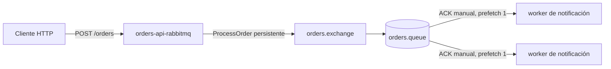
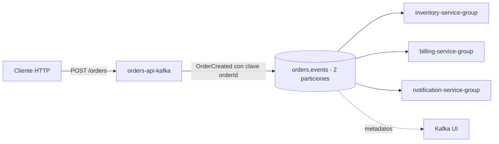

# Taller de pruebas de integración

Este repositorio implementa dos sistemas independientes de procesamiento de pedidos para realizar pruebas de integración y verificar propiedades reactivas:

- Una arquitectura dirigida por mensajes basada en RabbitMQ.
- Una arquitectura dirigida por eventos basada en Apache Kafka en modo KRaft.

Cada aplicación es un proyecto Spring Boot independiente con su propia configuración de Gradle, Gradle Wrapper, archivo de configuración, Dockerfile, proceso de ejecución y límites de arquitectura hexagonal. Las dos arquitecturas tienen archivos Docker Compose separados y están diseñadas para ejecutarse de forma independiente.

## Descripción general de las arquitecturas

### RabbitMQ



La API devuelve `202 Accepted` después de publicar el mensaje y nunca llama directamente al worker. RabbitMQ almacena una cola durable en un volumen persistente. Las instancias del worker compiten por los mensajes, confirman manualmente los procesamientos exitosos y vuelven a encolar las entregas fallidas.

### Kafka



Los tres consumidores funcionales utilizan grupos diferentes, por lo que cada servicio recibe todos los eventos. Las instancias adicionales de un mismo servicio comparten su grupo y distribuyen las particiones entre ellas. Kafka conserva los eventos y los offsets confirmados en un volumen persistente.

## Arquitectura hexagonal

Todos los servicios siguen la misma dirección de dependencias:

```text
dominio <- puertos y casos de uso de aplicación <- adaptadores y configuración de infraestructura
```

El dominio contiene registros y excepciones que no dependen del framework. Los puertos de entrada definen los casos de uso; los puertos de salida definen las dependencias del broker o las dependencias de negocio simuladas; y los adaptadores de infraestructura conectan REST, RabbitMQ, Kafka y el registro de logs con esos puertos. Los controladores y listeners solo traducen los datos de transporte e invocan los puertos de entrada.

## Estructura del repositorio

```text
.
├── rabbitmq-architecture
│   ├── docker-compose.yml
│   ├── orders-api-rabbitmq
│   └── notification-worker-rabbitmq
├── kafka-architecture
│   ├── docker-compose.yml
│   ├── orders-api-kafka
│   ├── inventory-consumer-kafka
│   ├── billing-consumer-kafka
│   └── notification-consumer-kafka
└── README.md
```

## Tecnologías

- Java 21
- Spring Boot 4.1.2
- Spring AMQP
- Spring for Apache Kafka
- Jakarta Validation
- JUnit y Spring Boot Test
- MockMvc
- Testcontainers 2.0.5
- RabbitMQ 4.1 con interfaz de administración
- Apache Kafka 4.1 en modo KRaft
- Kafka UI
- Docker y Docker Compose

## Requisitos previos

- Docker con Compose v2 o el comando independiente `docker-compose`.
- Al menos 6 GB de memoria disponible para Docker al ejecutar Kafka y todos los consumidores.
- Java 21 para realizar compilaciones desde el equipo local. No se necesita una instalación local de Gradle porque todos los servicios incluyen Gradle Wrapper.

Las credenciales predeterminadas son únicamente para desarrollo local. Cambie `RABBITMQ_USERNAME` y `RABBITMQ_PASSWORD` antes de utilizar la solución fuera de un entorno local desechable.

## Compilación

Compile cada servicio desde su propio directorio:

```bash
./gradlew clean build
```

Para compilar sin utilizar el wrapper incluido ni una instalación de Gradle en el equipo:

```bash
docker run --rm -v "$PWD:/workspace" -w /workspace gradle:9.2.1-jdk21-alpine gradle clean build --no-daemon
```

Docker Compose también construye el archivo JAR ejecutable de cada servicio mediante su Dockerfile de múltiples etapas.

## Ejecutar la arquitectura RabbitMQ

```bash
cd rabbitmq-architecture
docker compose up -d --build
docker compose ps
docker compose logs -f
```

Si Compose está instalado como un ejecutable independiente, reemplace `docker compose` por `docker-compose`.

La API está disponible en `http://localhost:3000`. La interfaz de RabbitMQ Management está disponible en `http://localhost:15672` con los valores configurados en `RABBITMQ_USERNAME` y `RABBITMQ_PASSWORD`. Para uso local, ambos tienen como valor predeterminado `orders`.

Escale el worker competitivo:

```bash
docker compose up -d --scale notification-worker-rabbitmq=2
```

Consulte únicamente los logs del worker:

```bash
docker compose logs -f notification-worker-rabbitmq
```

## Ejecutar la arquitectura Kafka

Detenga primero la arquitectura RabbitMQ porque las dos APIs utilizan el puerto 3000 del equipo anfitrión.

```bash
cd kafka-architecture
docker compose up -d --build
docker compose ps
docker compose logs -f
```

La API está disponible en `http://localhost:3000`, Kafka se expone para herramientas opcionales del equipo local en `localhost:29092` y Kafka UI está disponible en `http://localhost:8080`.

Escale un grupo de consumidores entre las dos particiones del topic:

```bash
docker compose up -d --scale inventory-consumer-kafka=2
```

Kafka UI permite consultar el contenido del topic, las claves, las particiones, los grupos de consumidores y los offsets.

## Endpoint de la API

Las dos arquitecturas exponen:

```text
POST /orders
Content-Type: application/json
```

Solicitud:

```json
{
  "customerName": "Pedro",
  "product": "Libro de arquitectura",
  "quantity": 1,
  "unitPrice": 85000
}
```

Respuesta de RabbitMQ:

```json
{
  "status": "accepted",
  "message": "Pedido recibido y enviado a RabbitMQ",
  "orderId": "ORD-...",
  "correlationId": "..."
}
```

Respuesta de Kafka:

```json
{
  "status": "accepted",
  "message": "Pedido recibido y evento OrderCreated publicado en Kafka",
  "orderId": "ORD-...",
  "correlationId": "..."
}
```

Ejemplo de solicitud:

```bash
curl -i http://localhost:3000/orders \
  -H 'Content-Type: application/json' \
  -d '{"customerName":"Pedro","product":"Libro de arquitectura","quantity":1,"unitPrice":85000}'
```

Las solicitudes inválidas devuelven un contrato de error estable con `timestamp`, `status`, `error`, `message`, `path`, `correlationId` y `validationErrors`.

## Pruebas

Ejecute las pruebas de un servicio desde el directorio correspondiente:

```bash
./gradlew test
```

Las pruebas de las APIs verifican solicitudes aceptadas, errores de Jakarta Validation, identificadores de trazabilidad y publicación en brokers reales proporcionados por Testcontainers. Las pruebas de los consumidores envían registros a brokers reales y verifican el consumo y la propagación de identificadores. Docker debe estar en ejecución para las pruebas de integración con los brokers.

## Verificación de recuperación y propiedades reactivas

### Caída del consumidor de RabbitMQ

1. Inicie la arquitectura RabbitMQ.
2. Detenga el worker con `docker compose stop notification-worker-rabbitmq`.
3. Envíe varios pedidos y confirme que la API continúa devolviendo `202`.
4. Abra RabbitMQ Management y verifique que `orders.queue` tenga mensajes listos.
5. Inicie el worker con `docker compose start notification-worker-rabbitmq`.
6. Verifique que la cantidad de mensajes listos regrese a cero y que los logs del worker muestren los valores correspondientes de `orderId`, `correlationId`, `messageId` y las confirmaciones manuales.

### Recuperación de mensajes no confirmados en RabbitMQ

Detenga un worker mientras procesa un mensaje. RabbitMQ vuelve a encolar una entrega no confirmada para que otro worker, o el worker reiniciado, la procese. Revise los contadores `Ready`, `Unacked` y `Total` de la cola, además de los logs de entrega.

### Caída de un consumidor de Kafka

1. Inicie la arquitectura Kafka.
2. Detenga un consumidor; por ejemplo: `docker compose stop inventory-consumer-kafka`.
3. Envíe varios pedidos y verifique que los otros dos grupos de consumidores continúen procesando.
4. En Kafka UI, consulte los eventos conservados y el lag de `inventory-service-group`.
5. Reinicie el consumidor y verifique que procese los offsets pendientes.

### Elasticidad

Escale el worker de RabbitMQ o el consumidor de inventario de Kafka como se mostró anteriormente, publique varios pedidos y compare los logs de los contenedores. RabbitMQ distribuye los mensajes entre los workers que compiten por la cola. Kafka asigna las dos particiones de `orders.events` entre las instancias de `inventory-service-group`.

## Detener y limpiar

Detenga los contenedores conservando los datos de los brokers:

```bash
docker compose down
```

Elimine los contenedores y los datos persistentes de los brokers:

```bash
docker compose down --volumes --remove-orphans
```

Ejecute el comando desde el directorio de la arquitectura que desea limpiar.
# orders
